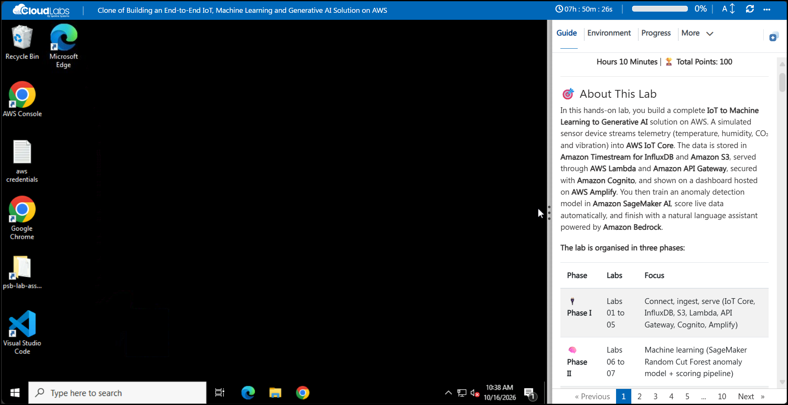
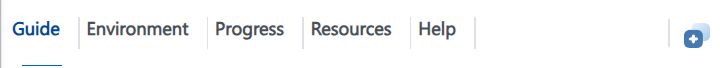
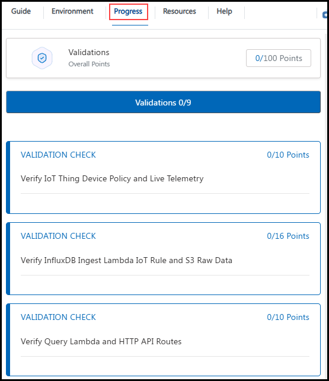

<style>
@keyframes psbBreathe{0%,100%{background-position:0% 0%,100% 100%;box-shadow:0 0 0 rgba(255,153,0,0)}50%{background-position:30% 20%,70% 80%;box-shadow:0 0 36px rgba(255,153,0,.10)}}
@keyframes psbPanel{0%,100%{box-shadow:0 4px 14px rgba(20,40,70,.06);border-color:#e3e9f1}50%{box-shadow:0 6px 26px rgba(255,153,0,.16);border-color:#ffd9a3}}
@keyframes psbCorner{0%,100%{width:26px;height:26px;opacity:.75}50%{width:46px;height:46px;opacity:1}}
@keyframes psbPop{0%{transform:scale(1)}40%{transform:scale(1.25)}100%{transform:scale(1)}}
.psbgs{background-size:220% 220%,220% 220%!important;animation:psbBreathe 9s ease-in-out infinite}
.psbgs .psb-panel{animation:psbPanel 7s ease-in-out infinite;transition:transform .25s ease}
.psbgs .psb-panel:nth-of-type(even){animation-delay:-3.5s}
.psbgs .psb-panel:hover{transform:translateY(-2px)}
.psbgs h1,.psbgs h2,.psbgs h3{color:#16202e!important}
.psbgs h2{border-bottom:2px solid transparent!important;border-image:linear-gradient(90deg,#ff9900,#4fc3f7) 1!important;padding-bottom:8px!important}
.psbgs h1+p,.psbgs h1+p b{color:#b35c00!important}
.psbgs table{border-radius:10px;overflow:hidden}
.psbgs th{color:#9a4f00!important;background:#fff3e2!important}
.psbgs tr{transition:background .2s ease}
.psbgs tbody tr:hover{background:#f4f9fd!important}
.psbgs blockquote{background:#eef8fd!important;border-left:4px solid #4fc3f7!important;border-radius:0 10px 10px 0}
.psbgs pre{background:#0f1724!important;border-radius:12px;padding:14px!important;overflow-x:auto!important;max-width:100%}
.psbgs pre,.psbgs pre code{color:#bfe7ff!important;background:#0f1724!important}
.psbgs .psb-shot{position:relative;margin:14px 0 20px;padding:8px;border-radius:12px;background:#f7f9fc;border:1px solid #e3e9f1}
.psbgs .psb-shot p{margin:0!important}
.psbgs .psb-shot::before,.psbgs .psb-shot::after{content:"";position:absolute;width:26px;height:26px;pointer-events:none;animation:psbCorner 3.2s ease-in-out infinite}
.psbgs .psb-shot::before{top:-2px;left:-2px;border-top:3px solid #ff9900;border-left:3px solid #ff9900;border-top-left-radius:12px}
.psbgs .psb-shot::after{bottom:-2px;right:-2px;border-bottom:3px solid #4fc3f7;border-right:3px solid #4fc3f7;border-bottom-right-radius:12px;animation-delay:-1.6s}
.psbgs .psb-shot img{display:block;max-width:100%;height:auto;margin:0 auto;border-radius:8px;transition:transform .25s ease,box-shadow .25s ease}
.psbgs .psb-shot img:hover{box-shadow:0 8px 24px rgba(20,40,70,.18)}
.psbgs .psb-shot img:active{transform:scale(.98)}
.psbgs a{color:#0b7fc0!important;transition:color .2s ease}
.psbgs a:hover{color:#ff8a00!important}
.psbgs a:active{animation:psbPop .35s ease}
/* CloudLabs inject values and copy buttons */
.psbgs [class]:not(.psb-panel):not(.psb-shot):not([class*=language]):not(code){color:#9a4f00!important;-webkit-text-fill-color:#9a4f00!important}
.psbgs img:not([src*="media/"]),.psbgs svg,.psbgs i,.psbgs button,.psbgs [class*=copy],.psbgs [class*=Copy],.psbgs [title*=opy]{cursor:pointer;transition:transform .15s ease,filter .15s ease}
.psbgs img:not([src*="media/"]):hover,.psbgs svg:hover,.psbgs i:hover,.psbgs button:hover,.psbgs [class*=copy]:hover,.psbgs [class*=Copy]:hover,.psbgs [title*=opy]:hover{transform:scale(1.15);filter:drop-shadow(0 0 4px rgba(255,153,0,.6))}
.psbgs img:not([src*="media/"]):active,.psbgs svg:active,.psbgs i:active,.psbgs button:active,.psbgs [class*=copy]:active,.psbgs [class*=Copy]:active,.psbgs [title*=opy]:active{animation:psbPop .35s ease;filter:drop-shadow(0 0 8px rgba(255,153,0,.9))}
@media (prefers-reduced-motion:reduce){.psbgs,.psbgs *,.psbgs .psb-shot::before,.psbgs .psb-shot::after{animation:none!important;transition:none!important}}
</style>

<div class="psbgs" style="background:radial-gradient(circle at 15% 10%,rgba(255,153,0,.06),transparent 45%),radial-gradient(circle at 85% 90%,rgba(79,195,247,.08),transparent 45%),#fbfcfe;border:1px solid #e6ebf2;border-radius:18px;padding:20px 10px 24px;margin:0 -20px;">

<h1 align="center">🚀 Getting Started: AWS Demo || Bedrock with Claude</h1>
<p align="center"><b>AWS Demo || Bedrock with Claude</b> | ⏱️ <b>Estimated Timing: 8 Hours 10 Minutes</b> | 🏆 <b>Total Points: 100</b></p>

<div class="psb-panel" style="background:#ffffff;border:1px solid #e3e9f1;border-radius:16px;padding:16px 14px;margin:16px 0;">

## 🎯 About This Lab

In this hands-on lab, you build a complete **IoT to Machine Learning to Generative AI** solution on AWS. A simulated sensor device streams telemetry (temperature, humidity, CO₂ and vibration) into **AWS IoT Core**. The data is stored in **Amazon Timestream for InfluxDB** and **Amazon S3**, served through **AWS Lambda** and **Amazon API Gateway**, secured with **Amazon Cognito**, and shown on a dashboard hosted on **AWS Amplify**. You then train an anomaly detection model in **Amazon SageMaker AI**, score live data automatically, and finish with a natural language assistant powered by **Amazon Bedrock**.

**The lab is organised in three phases:**

| Phase | Labs | Focus |
|---|---|---|
| 🔌 **Phase I** | Labs 01 to 05 | Connect, ingest, serve (IoT Core, InfluxDB, S3, Lambda, API Gateway, Cognito, Amplify) |
| 🧠 **Phase II** | Labs 06 to 07 | Machine learning (SageMaker Random Cut Forest anomaly model + scoring pipeline) |
| 🤖 **Phase III** | Labs 08 to 09 | Generative AI + operations (Bedrock assistant, CloudWatch, teardown) |

### 🗺️ Labs Overview

| Lab | Title | Phase | ⏱️ Timing | 🏆 Points |
|:---:|---|:---:|:---:|:---:|
| 01 | 🛰️ IoT Identity and Device Simulator | I | 45 min | 10 |
| 02 | 🔀 Rules Engine to InfluxDB and S3 | I | 65 min | 16 |
| 03 | 🔎 Query Lambda and HTTP API | I | 55 min | 10 |
| 04 | 🔐 Cognito Authentication | I | 40 min | 10 |
| 05 | 📊 Amplify Dashboard | I | 45 min | 9 |
| 06 | 🧪 SageMaker Anomaly Model | II | 70 min | 15 |
| 07 | ⚙️ Automated Scoring Pipeline | II | 50 min | 12 |
| 08 | 🤖 Bedrock Assistant | III | 60 min | 13 |
| 09 | 📈 Observability and Teardown | III | 40 min | 5 |
| | **Total** | | **8 h 10 min** | **100** |

### 🏗️ What you build

```text
Sensor simulator (VM) ──MQTT/TLS──> AWS IoT Core ──Rule──> Lambda ──> Timestream for InfluxDB
                                                   └──────> Amazon S3 (raw/)
InfluxDB ──> Query Lambda ──> API Gateway (Cognito JWT) ──> Amplify dashboard
S3 raw/ ──> SageMaker RCF model ──> Serverless endpoint <── Score Lambda (every 5 min)
Dashboard chat ──> Assistant Lambda ──> Amazon Bedrock (Converse API + tool use)
```

</div>

<div class="psb-panel" style="background:#ffffff;border:1px solid #e3e9f1;border-radius:16px;padding:16px 14px;margin:16px 0;">

## 🖥️ Lab Environment

The lab window is split into two parts:

- **Left side:** your lab virtual machine (VM), a Windows Server 2022 workstation.
- **Right side:** the lab guide, with the steps to complete each task.

Your lab window looks like this:

<div class="psb-shot">



</div>

### 📦 Pre-provisioned Resources

The following resources are already created for you. You do **not** need to create them.

| Resource | Name / Value |
|---|---|
| 🌍 **Region** | <inject key="LabRegion" enableCopy="true"/> (Asia Pacific (Singapore)) |
| 🪣 **S3 bucket** (empty) | <inject key="LabBucketName" enableCopy="true"/> |
| 🧪 **SageMaker Studio domain** | <inject key="SageMakerDomainName" enableCopy="true"/> |
| 👤 **SageMaker user profile** | **psb-lab-user** |
| 🔑 **SageMaker execution role** | **psb-lab-sagemaker-exec-<inject key="DeploymentID" enableCopy="false"/>** (can read and write the lab bucket) |
| 💻 **Lab VM** | **windowsvm-<inject key="DeploymentID" enableCopy="false"/>** (t3.medium) |
| 🧰 **VM tooling** | Chrome, Edge, VS Code, AWS CLI v2, Python 3.12 (python + pip on PATH), Node.js LTS (node / npm), Git |
| 📁 **Lab assets** | **C:\psb-lab-assets** + desktop shortcut **psb-lab-assets** |
| 📄 **Desktop files** | **aws credentials.txt** and the **AWS Console** shortcut |

> ℹ️ **Info:** In Lab 02 you create the **raw/**, **curated/** and **model/** folders in the S3 bucket. In Lab 06 you create the SageMaker space **psb-lab-space**.

### 📁 Lab Assets Folder

The **psb-lab-assets** folder on the desktop (**C:\psb-lab-assets**) contains everything you need:

| Folder / File | Contents |
|---|---|
| 🛰️ **simulator\\** | **simulate_pi.py** device simulator, **requirements.txt**, and **certs\\** (device certificates go here in Lab 01) |
| ⚡ **lambdas\\** | The 4 Lambda functions: **psb-ingest-telemetry**, **psb-query-telemetry**, **psb-score-telemetry**, **psb-assistant** (each with **lambda_function.py**) |
| 🧪 **test-events\\** | **sample-reading.json**, **direct-query.json**, **manual-run.json**, **ask-question.json** |
| 🔐 **policies\\** | IAM and IoT policy files (device policy, IoT rule trust and S3 write, Influx token read, score policy, assistant policy) |
| 📊 **dashboard\\** | React dashboard source (Vite + React 18) and prebuilt fallback **dist.zip** |
| 📓 **notebook\\** | SageMaker notebook **psb-anomaly-detection.ipynb** |
| 📝 **README.txt** | Short description of the folder |

### 🤖 About Bedrock and Claude

> ℹ️ **Info:** The lab title says **Claude**. The assistant you build in Lab 08 uses **Amazon Nova Lite** (APAC inference profile **apac.amazon.nova-lite-v1:0**) through the same Amazon Bedrock **Converse API**. Claude models can be swapped in by changing the **MODEL_ID** environment variable of the assistant Lambda function (and the model ARNs in its IAM policy). No code change is needed.

</div>

<div class="psb-panel" style="background:#ffffff;border:1px solid #e3e9f1;border-radius:16px;padding:16px 14px;margin:16px 0;">

## 🧭 Lab Window Controls

The top bar and the lab guide menu give you these controls:

<div class="psb-shot">


</div>

| # | Control | Use |
|:---:|---|---|
| 1 | **VM name** | Shows the lab VM you are connected to. |
| 2 | **Timer** | Time remaining in your lab session. |
| 3 | **Progress bar** | Your progress through the lab. |
| 4 | **A↕** | Change the text size of the lab guide. |
| 5 | **Refresh** | Reconnect the VM if the screen stops responding. |
| 6 | **More (...)** | Language, Delete and VM Native Clipboard options. |
| 7 | **Lab guide menu** | Guide, Environment, Progress, Resources and Help. |
| 8 | **Split window** | Split the lab guide and the VM into separate windows. |

### 6️⃣ More Options

Select **More (...)** in the top bar to open these options:

<div class="psb-shot">


</div>

| Option | Use |
|---|---|
| 🌍 **Language** | Switch the lab language, if multi-language support is enabled. |
| 🗑️ **Delete** | Delete the environment once your lab is complete. |
| 📋 **VM Native Clipboard** | Allows copying files within the VM. While it is on, text copied from your local PC cannot be pasted into the VM using keyboard shortcuts. You can turn it off at any time from **More (...)**. |

### 7️⃣ Lab Guide Menu

Use the tabs at the top of the lab guide to move between its sections:

<div class="psb-shot">



</div>

| Option | Use |
|---|---|
| 📖 **Guide** | All tasks and lab information. |
| 🔑 **Environment** | AWS console credentials and lab details. |
| 📈 **Progress** | Your points for validations. |
| ⚙️ **Resources** | Start, stop or restart the lab VM. |
| ❓ **Help** | Support information. |

### 📈 Progress

The **Progress** tab shows your overall points and the status of each **Validation** check. Each lab has one validation, and its points are shown in the lab header:

<div class="psb-shot">



</div>

### 🔑 Exploring Your Resources

To view your AWS console credentials and resource details, navigate to the **Environment** tab:

<div class="psb-shot">


</div>

### 🪟 Utilizing the Split Window Feature

For convenience, you can open the lab guide in a separate window by selecting the **Split Window** button from the top-right corner:

<div class="psb-shot">


</div>

### 🖥️ Managing Your Virtual Machine

You can start, stop or restart your virtual machine as needed from the **Resources** tab:

<div class="psb-shot">


</div>

### 📄 Page Navigation

Use **Previous**, the page numbers and **Next** at the bottom of the guide to move between pages:

<div class="psb-shot">


</div>

</div>

<div class="psb-panel" style="background:#ffffff;border:1px solid #e3e9f1;border-radius:16px;padding:16px 14px;margin:16px 0;">

## ✅ Validate Your Work

Each lab ends with a **Validation Check** that checks your work. Complete all tasks in the lab, scroll to the **Validation Check** at the end of the last task, and click **Validate**:

<div class="psb-shot">


</div>

- On success, the status shows **Success** and the points are added to your **Progress**.
- If a check fails, read the message, fix the issue and click **Validate** again.

> 💡 **Tip:** Validate as often as you like. There is no penalty and no limit.

</div>

<div class="psb-panel" style="background:#ffffff;border:1px solid #e3e9f1;border-radius:16px;padding:16px 14px;margin:16px 0;">

## 🔐 Sign In to the AWS Console

**Step 1:** On the lab VM desktop, double-click the **AWS Console** shortcut, or open the sign-in URL below in the browser:

| Detail | Value |
|---|---|
| 🔗 **Sign-in URL** | <inject key="SignInUrl" enableCopy="true"/> |
| 👤 **IAM username** | <inject key="AWSUserName" enableCopy="true"/> |
| 🔒 **Password** | <inject key="AWSPassword" enableCopy="true"/> |

> 💡 **Tip:** The same credentials are also saved in the **aws credentials.txt** file on the VM desktop.

**Step 2:** Enter the **IAM username (1)** and **Password (2)**, then click **Sign in (3)**:

<div class="psb-shot">


</div>

**Step 3:** In the top-right corner of the console, open the **Region** selector and choose **Asia Pacific (Singapore) ap-southeast-1**:

<div class="psb-shot">


</div>

> ⚠️ **Note:** Create **every** resource in **Asia Pacific (Singapore) ap-southeast-1**. The pre-provisioned resources and the validation checks only look in this region. If something "disappears" from a console page, check the region selector first.

</div>

<div class="psb-panel" style="background:#ffffff;border:1px solid #e3e9f1;border-radius:16px;padding:16px 14px;margin:16px 0;">

## 🔌 Connect Using RDP (Optional)

To use your own RDP client instead of the browser-based VM, connect with these details:

| Detail | Value |
|---|---|
| 💻 **Computer** | <inject key="WindowsVMPublicIP" enableCopy="true"/> |
| 👤 **Username** | <inject key="windowsvmAdminUsername" enableCopy="true"/> |
| 🔒 **Password** | <inject key="WindowsVMPassword" enableCopy="true"/> |

</div>

<div class="psb-panel" style="background:#ffffff;border:1px solid #e3e9f1;border-radius:16px;padding:16px 14px;margin:16px 0;">

## 🆘 Support Contact

The CloudLabs support team is available 24/7 via email and live chat.

- 📧 **Email:** <a href="mailto:cloudlabs-support@spektrasystems.com">cloudlabs-support@spektrasystems.com</a>
- 💬 **Live chat:** <a href="https://support.cloudlabs.ai/isv">https://support.cloudlabs.ai/isv</a>


Click **Next** to begin the lab.

</div>

<div class="psb-panel" style="background:#ffffff;border:1px solid #e3e9f1;border-radius:16px;padding:16px 14px;margin:16px 0;">

## 🎉 Happy Learning!

</div>

</div>
