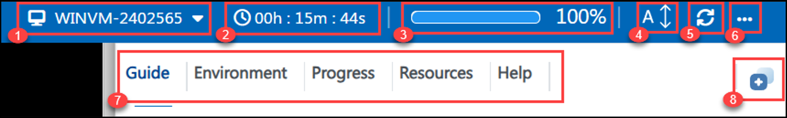
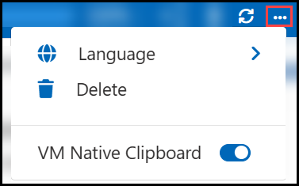
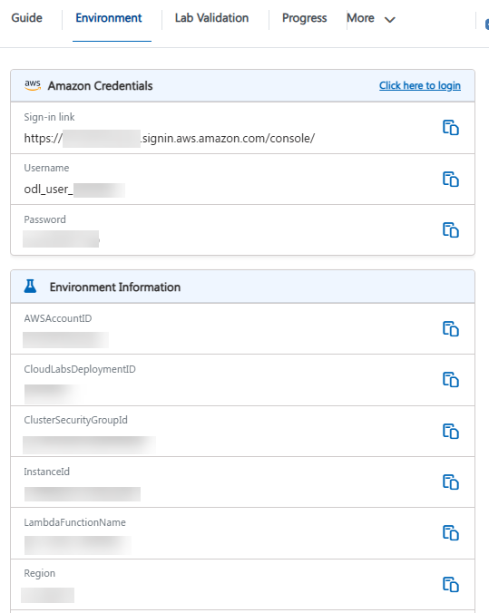
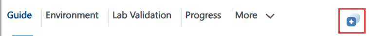
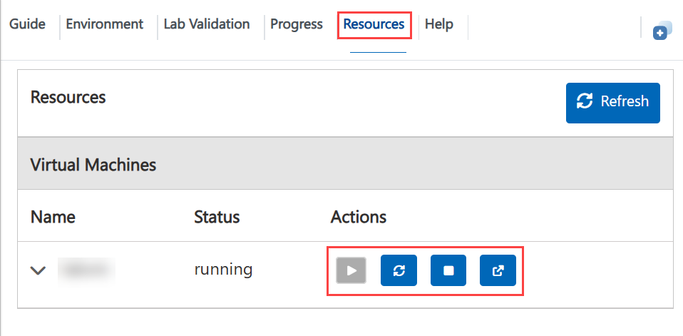
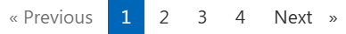
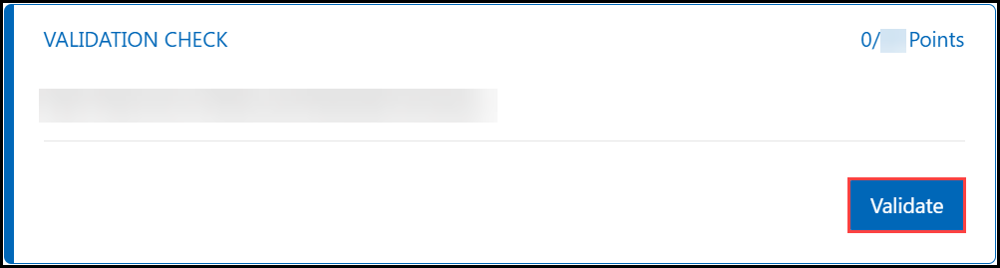
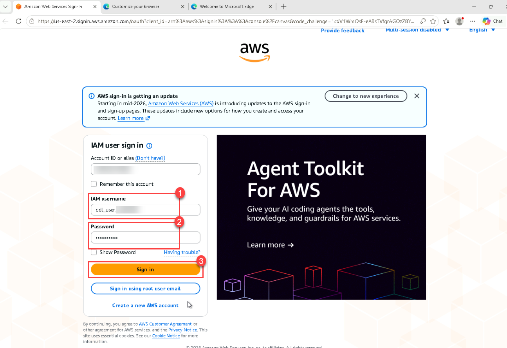
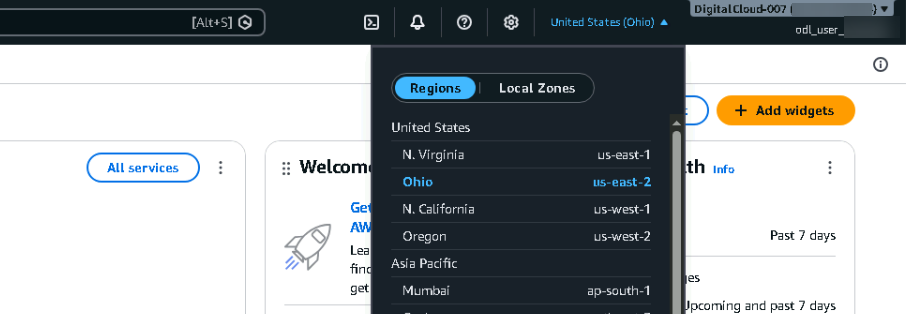

<h1 align="center">🚀 Getting Started: AWS Demo || Bedrock with Claude</h1>
<p align="center"><b>AWS Demo || Bedrock with Claude</b> | ⏱️ <b>Estimated Timing: 8 Hours 10 Minutes</b></p>

---

## 🎯 About This Lab

In this hands-on lab, you build a complete **IoT to Machine Learning to Generative AI** solution on AWS. A simulated sensor device streams telemetry (temperature, humidity, CO₂ and vibration) into **AWS IoT Core**. The data is stored in **Amazon Timestream for InfluxDB** and **Amazon S3**, served through **AWS Lambda** and **Amazon API Gateway**, secured with **Amazon Cognito**, and shown on a dashboard hosted on **AWS Amplify**. You then train an anomaly detection model in **Amazon SageMaker AI**, score live data automatically, and finish with a natural language assistant powered by **Amazon Bedrock**.

**The lab is organised in three phases:**

| Phase | Labs | Focus |
|---|---|---|
| 🔌 **Phase I** | Labs 01 to 05 | Connect, ingest, serve (IoT Core, InfluxDB, S3, Lambda, API Gateway, Cognito, Amplify) |
| 🧠 **Phase II** | Labs 06 to 07 | Machine learning (SageMaker Random Cut Forest anomaly model + scoring pipeline) |
| 🤖 **Phase III** | Labs 08 to 09 | Generative AI + operations (Bedrock assistant, CloudWatch, teardown) |

### 🗺️ Labs Overview

| Lab | Title | Phase | ⏱️ Timing |
|:---:|---|:---:|:---:|
| 01 | 🛰️ IoT Identity and Device Simulator | I | 45 min |
| 02 | 🔀 Rules Engine to InfluxDB and S3 | I | 65 min |
| 03 | 🔎 Query Lambda and HTTP API | I | 55 min |
| 04 | 🔐 Cognito Authentication | I | 40 min |
| 05 | 📊 Amplify Dashboard | I | 45 min |
| 06 | 🧪 SageMaker Anomaly Model | II | 70 min |
| 07 | ⚙️ Automated Scoring Pipeline | II | 50 min |
| 08 | 🤖 Bedrock Assistant | III | 60 min |
| 09 | 📈 Observability and Teardown | III | 40 min |
| | **Total** | | **8 h 10 min** |

### 🏗️ What you build

```text
Sensor simulator (VM) ──MQTT/TLS──> AWS IoT Core ──Rule──> Lambda ──> Timestream for InfluxDB
                                                   └──────> Amazon S3 (raw/)
InfluxDB ──> Query Lambda ──> API Gateway (Cognito JWT) ──> Amplify dashboard
S3 raw/ ──> SageMaker RCF model ──> Serverless endpoint <── Score Lambda (every 5 min)
Dashboard chat ──> Assistant Lambda ──> Amazon Bedrock (Converse API + tool use)
```

---

## 🖥️ Lab Environment

The lab window is split into two parts:

- **Left side:** your lab virtual machine (VM), a Windows Server 2022 workstation.
- **Right side:** the lab guide, with the steps to complete each task.

### 📦 Pre-provisioned Resources

The following resources are already created for you. You do **not** need to create them.

| Resource | Name / Value |
|---|---|
| 🌍 **Region** | <inject key="LabRegion" enableCopy="true"/> (Asia Pacific (Singapore)) |
| 🪣 **S3 bucket** (empty) | <inject key="LabBucketName" enableCopy="true"/> |
| 🧪 **SageMaker Studio domain** | <inject key="SageMakerDomainName" enableCopy="true"/> |
| 👤 **SageMaker user profile** | **psb-lab-user** |
| 🔑 **SageMaker execution role** | **psb-lab-sagemaker-exec-<inject key="DeploymentID" enableCopy="false"/>** (can read and write the lab bucket) |
| 💻 **Lab VM** | **windowsvm-<inject key="DeploymentID" enableCopy="false"/>** (t3.medium) |
| 🧰 **VM tooling** | Chrome, Edge, VS Code, AWS CLI v2, Python 3.12 (python + pip on PATH), Node.js LTS (node / npm), Git |
| 📁 **Lab assets** | **C:\psb-lab-assets** + desktop shortcut **psb-lab-assets** |
| 📄 **Desktop files** | **aws credentials.txt** and the **AWS Console** shortcut |

> ℹ️ **Info:** In Lab 02 you create the **raw/**, **curated/** and **model/** folders in the S3 bucket. In Lab 06 you create the SageMaker space **psb-lab-space**.

### 📁 Lab Assets Folder

The **psb-lab-assets** folder on the desktop (**C:\psb-lab-assets**) contains everything you need:

| Folder / File | Contents |
|---|---|
| 🛰️ **simulator\\** | **simulate_pi.py** device simulator, **requirements.txt**, and **certs\\** (device certificates go here in Lab 01) |
| ⚡ **lambdas\\** | The 4 Lambda functions: **psb-ingest-telemetry**, **psb-query-telemetry**, **psb-score-telemetry**, **psb-assistant** (each with **lambda_function.py**) |
| 🧪 **test-events\\** | **sample-reading.json**, **direct-query.json**, **manual-run.json**, **ask-question.json** |
| 🔐 **policies\\** | IAM and IoT policy files (device policy, IoT rule trust and S3 write, Influx token read, score policy, assistant policy) |
| 📊 **dashboard\\** | React dashboard source (Vite + React 18) and prebuilt fallback **dist.zip** |
| 📓 **notebook\\** | SageMaker notebook **psb-anomaly-detection.ipynb** |
| 📝 **README.txt** | Short description of the folder |

### 🤖 About Bedrock and Claude

> ℹ️ **Info:** The lab title says **Claude**. The assistant you build in Lab 08 uses **Amazon Nova Lite** (APAC inference profile **apac.amazon.nova-lite-v1:0**) through the same Amazon Bedrock **Converse API**. Claude models can be swapped in by changing the **MODEL_ID** environment variable of the assistant Lambda function (and the model ARNs in its IAM policy). No code change is needed.

---

## 🧭 Lab Window Controls

Your lab VM (left) and the lab **Guide** (right) open together in your web browser.



| # | Control | Use |
|:---:|---|---|
| 1 | **VM name** | Shows the lab VM you are connected to. |
| 2 | **Timer** | Time remaining in your lab session. |
| 3 | **Progress bar** | Your progress through the lab. |
| 4 | **A↕** | Change the text size of the lab guide. |
| 5 | **Refresh** | Reconnect the VM if the screen stops responding. |
| 6 | **More (...)** | Language, Delete and VM Native Clipboard options. |
| 7 | **Lab guide menu** | Guide, Environment, Progress, Resources and Help. |
| 8 | **Split window** | Split the lab guide and the VM into separate windows. |

### 6️⃣ More Options



| Option | Use |
|---|---|
| 🌍 **Language** | Switch the lab language, if multi-language support is enabled. |
| 🗑️ **Delete** | Delete the environment once your lab is complete. |
| 📋 **VM Native Clipboard** | Allows copying files within the VM. While it is on, text copied from your local PC cannot be pasted into the VM using keyboard shortcuts. You can turn it off at any time from **More (...)**. |

### 7️⃣ Lab Guide Menu

| Option | Use |
|---|---|
| 📖 **Guide** | All tasks and lab information. |
| 🔑 **Environment** | AWS console credentials and lab details. |
| 📈 **Progress** | Your points for validations. |
| ⚙️ **Resources** | Start, stop or restart the lab VM. |
| ❓ **Help** | Support information. |

### 🔑 Exploring Your Resources

To view your AWS console credentials and resource details, navigate to the **Environment** tab.



### 🪟 Utilizing the Split Window Feature

For convenience, you can open the lab guide in a separate window by selecting the **Split Window** button from the top-right corner.



### 🖥️ Managing Your Virtual Machine

You can start, stop or restart your virtual machine as needed from the **Resources** tab.



### 📄 Page Navigation

Use **Previous**, the page numbers and **Next** at the bottom of the guide to move between pages.



---

## ✅ Validate Your Work

Each lab ends with a **Validate** button that checks your work.

1. Complete all tasks in the lab.
1. Scroll to the **Validation Check** at the end of the last task.
1. Click **Validate**.

    

- On success, the status shows **Success** and the points are added to your **Progress**.
- If a check fails, read the message, fix the issue and click **Validate** again.

> 💡 **Tip:** Validate as often as you like. There is no penalty and no limit.

---

## 🔐 Sign In to the AWS Console

1. On the lab VM desktop, double-click the **AWS Console** shortcut, or open the sign-in URL below in the browser:

    | Detail | Value |
    |---|---|
    | 🔗 **Sign-in URL** | <inject key="SignInUrl" enableCopy="true"/> |
    | 👤 **IAM username** | <inject key="AWSUserName" enableCopy="true"/> |
    | 🔒 **Password** | <inject key="AWSPassword" enableCopy="true"/> |

1. Enter the **IAM username (1)** and **Password (2)**, then click **Sign in (3)**.

    

    > 💡 **Tip:** The same credentials are also saved in the **aws credentials.txt** file on the VM desktop.

1. In the top-right corner of the console, open the **Region** selector and choose **Asia Pacific (Singapore) ap-southeast-1**.

    

> ⚠️ **Note:** Create **every** resource in **Asia Pacific (Singapore) ap-southeast-1**. The pre-provisioned resources and the validation checks only look in this region. If something "disappears" from a console page, check the region selector first.

---

## 🔌 Connect Using RDP (Optional)

To use your own RDP client instead of the browser-based VM, connect with these details:

| Detail | Value |
|---|---|
| 💻 **Computer** | <inject key="WindowsVMPublicIP" enableCopy="true"/> |
| 👤 **Username** | <inject key="windowsvmAdminUsername" enableCopy="true"/> |
| 🔒 **Password** | <inject key="WindowsVMPassword" enableCopy="true"/> |

---

## 🆘 Support Contact

The CloudLabs support team is available 24/7 via email and live chat.

- 📧 **Email:** <a href="mailto:cloudlabs-support@spektrasystems.com">cloudlabs-support@spektrasystems.com</a>
- 💬 **Live chat:** <a href="https://support.cloudlabs.ai/isv">https://support.cloudlabs.ai/isv</a>

---

Click **Next** to begin the lab.

## 🎉 Happy Learning!
