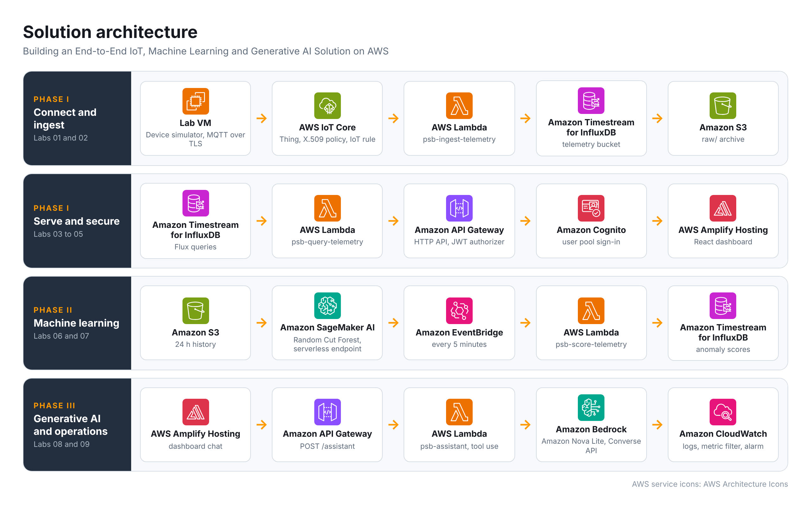

<style>
@property --psbA{syntax:'<angle>';inherits:false;initial-value:0deg}
@keyframes psbSpin{to{--psbA:360deg}}
@keyframes psbAurora{0%{background-position:0% 50%}50%{background-position:100% 50%}100%{background-position:0% 50%}}
@keyframes psbSweep{0%{background-position:-150% 0}55%,100%{background-position:250% 0}}
@keyframes psbOrb{0%,100%{transform:translate(0,0) scale(1);opacity:.5}50%{transform:translate(40px,-16px) scale(1.18);opacity:.9}}
@keyframes psbDrop{0%{opacity:0;transform:translateY(-12px)}100%{opacity:1;transform:none}}
@keyframes psbRise{0%{opacity:0;transform:translateY(20px)}100%{opacity:1;transform:none}}
@keyframes psbLine{0%,100%{width:90px}50%{width:160px}}
@keyframes psbBar{0%{background-position:0% 0}100%{background-position:200% 0}}
@keyframes psbRGB{0%{box-shadow:0 0 0 2px rgba(255,59,59,.55),0 0 22px rgba(255,59,59,.45)}33%{box-shadow:0 0 0 2px rgba(46,204,113,.55),0 0 22px rgba(46,204,113,.45)}66%{box-shadow:0 0 0 2px rgba(59,130,246,.6),0 0 22px rgba(59,130,246,.5)}100%{box-shadow:0 0 0 2px rgba(255,59,59,.55),0 0 22px rgba(255,59,59,.45)}}
@keyframes psbBurst{0%{box-shadow:0 0 0 0 rgba(255,59,59,.8),0 0 0 0 rgba(46,204,113,.7),0 0 0 0 rgba(59,130,246,.7)}100%{box-shadow:0 0 0 10px rgba(255,59,59,0),0 0 0 18px rgba(46,204,113,0),0 0 0 26px rgba(59,130,246,0)}}
@keyframes psbHalo{0%,100%{box-shadow:0 0 0 0 rgba(233,185,73,0),0 0 10px rgba(233,185,73,.25)}50%{box-shadow:0 0 0 3px rgba(20,184,166,.15),0 0 22px rgba(20,184,166,.45)}}
@keyframes psbHit{0%{transform:scale(1)}35%{transform:scale(1.22)}70%{transform:scale(.95)}100%{transform:scale(1)}}
.psbgs{position:relative}
/* hero */
.psbgs .psb-hero{background-size:300% 300%!important;animation:psbAurora 14s ease infinite,psbDrop .6s ease-out both;box-shadow:0 12px 32px rgba(15,27,45,.30)}
.psbgs .psb-hero::before{content:"";position:absolute;width:300px;height:300px;left:-80px;top:-110px;border-radius:50%;background:radial-gradient(closest-side,rgba(233,185,73,.40),transparent);box-shadow:520px 160px 120px 40px rgba(20,184,166,.22);animation:psbOrb 10s ease-in-out infinite;pointer-events:none}
.psbgs .psb-hero::after{content:"";position:absolute;inset:0;background:linear-gradient(110deg,transparent 35%,rgba(255,255,255,.12) 50%,transparent 65%);background-size:250% 100%;animation:psbSweep 6s ease-in-out infinite;pointer-events:none}
.psbgs .psb-title{color:#ffffff!important;text-align:center!important}
.psbgs .psb-hero>div{position:relative;z-index:2}
.psbgs .psb-hero::before{z-index:0}
.psbgs .psb-hero::after{z-index:1}
.psbgs .psb-line{animation:psbLine 4s ease-in-out infinite}
.psbgs .psb-chip{transition:transform .2s ease;cursor:default}
.psbgs .psb-chip *{color:#ffffff!important;-webkit-text-fill-color:#ffffff!important}
.psbgs .psb-chip:hover{transform:translateY(-3px);animation:psbRGB 1.6s linear infinite}
.psbgs .psb-chip:active{animation:psbHit .3s ease,psbBurst .5s ease-out}
/* framed cards with a thick animated border */
.psbgs .psb-panel{position:relative;border:2px solid #1f2a4d!important;background:#ffffff!important;box-shadow:0 6px 18px rgba(11,16,32,.08);animation:psbRise .6s cubic-bezier(.2,.8,.2,1) both;transition:transform .25s ease,box-shadow .25s ease}
.psbgs .psb-panel:nth-of-type(2){animation-delay:.08s}.psbgs .psb-panel:nth-of-type(3){animation-delay:.16s}.psbgs .psb-panel:nth-of-type(4){animation-delay:.24s}
.psbgs .psb-panel:nth-of-type(5){animation-delay:.32s}.psbgs .psb-panel:nth-of-type(6){animation-delay:.4s}.psbgs .psb-panel:nth-of-type(7){animation-delay:.48s}
.psbgs .psb-panel:hover{transform:translateY(-2px);box-shadow:0 12px 28px rgba(11,16,32,.14)}
/* headings */
.psbgs h2{border:0!important;padding-bottom:12px!important;position:relative;color:#16191f!important;font-weight:700!important}
.psbgs h2::after{content:"";position:absolute;left:0;bottom:0;height:3px;width:100%;border-radius:3px;background:linear-gradient(90deg,#e9b949,#14b8a6 55%,rgba(20,184,166,0))}
.psbgs h3{color:#1b1f3b!important;font-weight:700!important;margin-top:22px!important}
/* framed icons */
.psbgs .psb-ico{border:2px solid transparent!important;background:linear-gradient(#ffffff,#ffffff) padding-box,conic-gradient(from var(--psbA),#e9b949,#14b8a6,#3b2f8f,#22d3ee,#e9b949) border-box!important;animation:psbSpin 5s linear infinite,psbHalo 3.2s ease-in-out infinite;transition:transform .2s ease}
.psbgs .psb-ico:hover{transform:scale(1.15) rotate(-4deg);animation:psbSpin 1.2s linear infinite,psbRGB 1.2s linear infinite}
.psbgs .psb-ico:active{animation:psbHit .3s ease,psbBurst .5s ease-out}
/* tables */
.psbgs table{border-radius:10px;overflow:hidden;box-shadow:0 2px 10px rgba(15,27,45,.06)}
.psbgs th{color:#ffffff!important;background:#1b1f3b!important;border-color:#1b1f3b!important;border-bottom:2px solid #e9b949!important}
.psbgs tbody tr{transition:background .2s ease,box-shadow .2s ease}
.psbgs tbody tr:hover{background:#fbf6e6!important;box-shadow:inset 4px 0 0 #e9b949}
/* tips */
.psbgs blockquote{background:#effcfa!important;border-left:4px solid #14b8a6!important;border-radius:0 10px 10px 0;transition:transform .2s ease}
.psbgs blockquote:hover{transform:translateX(3px)}
/* screenshots: thick full animated frame, RGB glow on hover, burst on click */
.psbgs .psb-shot{position:relative;margin:16px 2px 22px;padding:4px;border-radius:14px;border:3px solid transparent;background:linear-gradient(#ffffff,#ffffff) padding-box,conic-gradient(from var(--psbA),#e9b949,#14b8a6 25%,#3b2f8f 50%,#22d3ee 75%,#e9b949) border-box;animation:psbSpin 7s linear infinite,psbHalo 4s ease-in-out infinite;transition:transform .25s ease}
.psbgs .psb-shot p{margin:0!important}
.psbgs .psb-shot img{display:block;max-width:100%;height:auto;margin:0 auto;border:0!important;border-radius:9px;box-shadow:none!important}
.psbgs .psb-shot:hover{transform:translateY(-2px);animation:psbSpin 2s linear infinite,psbRGB 1.8s linear infinite}
.psbgs .psb-shot:active{transform:scale(.99);animation:psbSpin 2s linear infinite,psbBurst .55s ease-out}
.psbgs pre{max-width:100%;overflow-x:auto}
.psbgs td,.psbgs th{overflow-wrap:anywhere}
/* links */
.psbgs a{color:#0f766e!important;font-weight:600;transition:color .2s ease}
.psbgs a:hover{color:#b7791f!important}
.psbgs a:active{display:inline-block;animation:psbHit .3s ease}
/* CloudLabs inject values and copy buttons */
.psbgs td [class]:not([class^=psb]):not(pre):not(code):not(pre *):not(code *):not(:has(pre)),.psbgs p [class]:not([class^=psb]):not(pre):not(code):not(pre *):not(code *):not(:has(pre)),.psbgs li [class]:not([class^=psb]):not(pre):not(code):not(pre *):not(code *):not(:has(pre)){color:#0f766e!important;-webkit-text-fill-color:#0f766e!important;font-weight:600}
/* code blocks: same width as the text around them, CloudLabs colours kept */
.psbgs li pre,.psbgs li *:has(pre){margin-left:0!important;margin-right:0!important;width:100%!important;max-width:100%!important;min-width:0!important;box-sizing:border-box!important}
.psbgs div:has(> pre){margin-left:0!important;margin-right:0!important}
.psbgs td img:not([class^=psb]),.psbgs td svg,.psbgs td i,.psbgs td button,.psbgs [class*=copy],.psbgs [class*=Copy],.psbgs [title*=opy]{cursor:pointer;border-radius:6px;transition:transform .15s ease}
.psbgs td img:not([class^=psb]):hover,.psbgs td svg:hover,.psbgs td i:hover,.psbgs td button:hover,.psbgs [class*=copy]:hover,.psbgs [class*=Copy]:hover,.psbgs [title*=opy]:hover{transform:scale(1.2);animation:psbRGB 1.2s linear infinite}
.psbgs td img:not([class^=psb]):active,.psbgs td svg:active,.psbgs td i:active,.psbgs td button:active,.psbgs [class*=copy]:active,.psbgs [class*=Copy]:active,.psbgs [title*=opy]:active{animation:psbHit .3s ease,psbBurst .5s ease-out}
/* compact, uniform spacing */
.psbgs p{margin:0 0 8px!important}
.psbgs ol,.psbgs ul{padding-left:1.35em!important;margin:4px 0 8px!important}
.psbgs li{margin:0 0 6px!important}
.psbgs li>p{margin:0 0 6px!important}
.psbgs li>*:last-child{margin-bottom:0!important}
.psbgs table{width:100%!important;margin:6px 0 10px!important}
.psbgs th,.psbgs td{padding:7px 10px!important}
.psbgs blockquote{margin:6px 0 10px!important;padding:8px 12px!important}
.psbgs blockquote p{margin:0!important}
.psbgs pre{margin:6px 0 10px!important}
.psbgs h2{margin:0 0 10px!important}
.psbgs h3{margin:14px 0 6px!important}
.psbgs h4{margin:12px 0 6px!important}
.psbgs .psb-panel>*:last-child{margin-bottom:0!important}
.psbgs .psb-panel{padding:14px 12px!important;margin:14px 0!important}
.psbgs .psb-shot{margin:6px 0 10px!important;padding:3px!important}
.psbgs .psb-ico{width:1.7em!important;height:1.7em!important;margin-right:6px!important}
/* v7: vibrant highlights instead of plain bold, icons sized to the text, tight spacing */
.psbgs strong,.psbgs b{color:#0e7490!important;font-weight:600!important}
.psbgs th strong,.psbgs th b,.psbgs .psb-hero b{color:inherit!important}
.psbgs h1 strong,.psbgs h2 strong,.psbgs h3 strong{color:inherit!important}
.psbgs .psb-ico{width:1.3em!important;height:1.3em!important;margin-right:.35em!important;vertical-align:-0.22em!important;border-radius:7px!important;font-size:1em!important;line-height:1!important}
.psbgs .psb-ico img{width:.95em!important;height:.95em!important}
.psbgs h2 .psb-ico,.psbgs h3 .psb-ico{font-size:1em!important}
.psbgs td .psb-ico{font-size:.95em!important}
.psbgs .psb-panel{padding:10px 10px!important;margin:10px 0!important}
.psbgs ol{padding-left:1.75em!important;margin:2px 0 6px!important}
.psbgs ul{padding-left:1.15em!important;margin:2px 0 6px!important}
.psbgs img{max-width:100%!important;height:auto!important}
.psbgs li{margin:0 0 4px!important;padding-left:0!important}
.psbgs li>p,.psbgs p{margin:0 0 6px!important}
.psbgs table{display:table!important;width:100%!important;max-width:100%!important;margin:4px 0 8px!important}
.psbgs th,.psbgs td{padding:6px 8px!important}
.psbgs blockquote{margin:4px 0 8px!important;padding:6px 10px!important}
.psbgs pre{margin:4px 0 8px!important}
.psbgs .psb-shot{margin:4px 0 8px!important;padding:2px!important}
.psbgs h2{margin:0 0 8px!important;padding-bottom:8px!important}
.psbgs h3{margin:10px 0 4px!important}
@media (prefers-reduced-motion:reduce){.psbgs *,.psbgs *::before,.psbgs *::after{animation:none!important;transition:none!important}}
</style>

<div class="psbgs">

<div class="psb-hero" style="position:relative;overflow:hidden;border-radius:16px;padding:28px 20px 24px;margin:0 0 6px;text-align:center;color:#ffffff;background:linear-gradient(120deg,#070b1a,#121a3a,#0d2b36,#16123a);">
<div class="psb-title" style="color:#ffffff;font-size:1.6em;font-weight:700;line-height:1.3;text-align:center;">Building an End-to-End IoT, Machine Learning and Generative AI Solution on AWS</div>
<div class="psb-line" style="width:90px;height:3px;margin:14px auto 12px;border-radius:3px;background:linear-gradient(90deg,#e9b949,#14b8a6);"></div>
<div class="psb-sub" style="color:#f2cc6b;font-weight:700;letter-spacing:.08em;text-align:center;">Lab Overview</div>
<div class="psb-meta" style="color:#d5dbe3;margin-top:6px;text-align:center;">8 Hours 10 Minutes&nbsp;&nbsp;|&nbsp;&nbsp;100 Points&nbsp;&nbsp;|&nbsp;&nbsp;9 Labs</div>
</div>

**Overall Estimated Duration:** 8 Hours 10 Minutes

<div class="psb-panel" style="background:#ffffff;border:1px solid #d5dbe3;border-radius:16px;padding:18px 16px;margin:24px 0;">

## <span class="psb-ico" style="display:inline-flex;align-items:center;justify-content:center;width:1.9em;height:1.9em;border-radius:9px;margin-right:8px;vertical-align:middle;border:1px solid #dfe5ee;background:#ffffff;">📖</span>Overview

Modern industrial and campus IoT solutions are rarely a single service. They are a pipeline: a device at the edge, a secure ingestion layer, a time-series store, an API, a dashboard, a model that finds what a human would miss, and, increasingly, an assistant that lets a non-specialist ask questions of the data in plain language.

This lab builds that entire pipeline on AWS, end to end, in three phases.

In **Phase I** you provision a device identity in AWS IoT Core, connect a Raspberry Pi sensor gateway over MQTT with mutual TLS, route its telemetry through the IoT Rules Engine into Amazon Timestream for InfluxDB and Amazon S3, expose it through a serverless API built on AWS Lambda and Amazon API Gateway, secure that API with Amazon Cognito, and publish a React dashboard on AWS Amplify Hosting.

In **Phase II** you use Amazon SageMaker AI to train an unsupervised anomaly-detection model on the telemetry you have collected, deploy it to a serverless inference endpoint, and close the loop by writing anomaly scores back into the same pipeline so the dashboard can display them.

In **Phase III** you build a natural-language assistant on Amazon Bedrock that answers questions such as "was anything unusual in the north lab in the last two hours?" by calling your own API as a tool.

You will finish with a working, secured, monitored solution and, more importantly, with a clear picture of how the pieces fit together and what each one costs.

> **A note on the Raspberry Pi.** This lab environment runs entirely in your browser, so the physical Raspberry Pi is represented by a device simulator that runs on your Lab VM. The simulator uses a real X.509 device certificate, connects to the real AWS IoT Core endpoint over TLS on port 8883, and publishes the same payload on the same topic that a physical Pi would. Everything from AWS IoT Core onwards is identical.

</div>

<div class="psb-panel" style="background:#ffffff;border:1px solid #d5dbe3;border-radius:16px;padding:18px 16px;margin:24px 0;">

## <span class="psb-ico" style="display:inline-flex;align-items:center;justify-content:center;width:1.9em;height:1.9em;border-radius:9px;margin-right:8px;vertical-align:middle;border:1px solid #dfe5ee;background:#ffffff;">🏁</span>Objective

This lab is designed to equip participants with hands-on experience in building a complete IoT-to-AI solution on AWS. By completing this lab, participants will learn to:

- **Provision a secure device identity:** Create an AWS IoT Core Thing, generate an X.509 certificate, author a least-privilege IoT policy, and connect a device over MQTT with mutual TLS. Participants will establish a trusted, authenticated channel between an edge device and the cloud.
- **Route telemetry with the IoT Rules Engine:** Write a rule with a SQL statement and fan a single message out to two destinations. Participants will build a serverless ingestion path that stores telemetry in both a time-series database and an object store without running a server.
- **Operate a managed time-series database:** Provision Amazon Timestream for InfluxDB, write with the InfluxDB line protocol, and read with Flux queries. Participants will store and query high-frequency sensor data using a purpose-built engine.
- **Build a serverless API:** Create AWS Lambda functions and an Amazon API Gateway HTTP API to expose telemetry and analytics to a frontend. Participants will design and deploy a serverless REST interface over their data.
- **Secure an API with managed identity:** Create an Amazon Cognito user pool and attach a JWT authorizer to the API. Participants will implement authentication and authorization for a web application without writing an auth server.
- **Deploy a modern web frontend:** Build and publish a React dashboard on AWS Amplify Hosting. Participants will deliver a hosted, HTTPS-served single-page application backed by their own API.
- **Train and deploy a machine-learning model:** Use Amazon SageMaker AI to prepare data, train a Random Cut Forest anomaly-detection model, evaluate it, and deploy it to a serverless inference endpoint. Participants will take a model from raw telemetry to a callable endpoint.
- **Operationalise inference:** Schedule a Lambda function to score recent readings and write results back into the pipeline. Participants will build a closed-loop ML system rather than a one-off notebook experiment.
- **Build a generative-AI assistant:** Use the Amazon Bedrock Converse API with tool use to let a foundation model query the learner's own telemetry API and answer questions in natural language. Participants will implement the agent tool-calling pattern from first principles.
- **Apply operational and cost discipline:** Configure CloudWatch log retention, a metric filter and an alarm; store credentials in AWS Secrets Manager; and tear down the resources that keep billing. Participants will apply production hygiene to a cloud solution.

</div>

<div class="psb-panel" style="background:#ffffff;border:1px solid #d5dbe3;border-radius:16px;padding:18px 16px;margin:24px 0;">

## <span class="psb-ico" style="display:inline-flex;align-items:center;justify-content:center;width:1.9em;height:1.9em;border-radius:9px;margin-right:8px;vertical-align:middle;border:1px solid #dfe5ee;background:#ffffff;">📋</span>Pre-requisites

Participants should have basic knowledge and understanding of the following:

- **AWS Account:** Access to an AWS account with permissions to create IoT, storage, serverless, machine-learning and generative-AI resources. This is provided by your lab environment.
- **Cloud Fundamentals:** Understanding of regions, IAM roles and policies, and the AWS Management Console.
- **Python:** Ability to read and lightly modify Python code. You will not be asked to write anything from scratch; all code is provided.
- **REST and JSON:** Familiarity with HTTP methods, status codes and JSON payload structures.
- **Command Line:** Comfort running commands in a Windows terminal (PowerShell) and reading their output.
- **IoT Concepts (helpful, not required):** Awareness of MQTT publish/subscribe, topics and TLS client certificates.
- **Machine Learning (helpful, not required):** Awareness of what training and inference mean. No prior SageMaker experience is assumed.

</div>

<div class="psb-panel" style="background:#ffffff;border:1px solid #d5dbe3;border-radius:16px;padding:18px 16px;margin:24px 0;">

## <span class="psb-ico" style="display:inline-flex;align-items:center;justify-content:center;width:1.9em;height:1.9em;border-radius:9px;margin-right:8px;vertical-align:middle;border:1px solid #dfe5ee;background:#ffffff;">🏗️</span>Architecture

This hands-on lab covers a complete IoT-to-AI solution architecture on AWS, built in three phases that stack on one another.

**Phase I** establishes the data path. A simulated Raspberry Pi sensor gateway on the Lab VM authenticates to AWS IoT Core with an X.509 certificate and publishes JSON telemetry over MQTT. A single IoT rule fans that message out to two actions: an AWS Lambda function that writes it into Amazon Timestream for InfluxDB using the InfluxDB line protocol, and a direct Amazon S3 action that lands the raw JSON as a training corpus. A second Lambda function reads the time-series data back with a Flux query and serves it through an Amazon API Gateway HTTP API, protected by an Amazon Cognito JWT authorizer. A React single-page application, hosted on AWS Amplify, signs the user in against Cognito and renders the telemetry.

**Phase II** adds intelligence. Amazon SageMaker Studio reads the accumulated raw telemetry from S3, prepares it, and runs a SageMaker training job using the built-in Random Cut Forest algorithm, an unsupervised anomaly detector well suited to sensor time series. The trained model is deployed to a SageMaker Serverless Inference endpoint, which bills only for the milliseconds it computes. A scheduled Lambda function pulls the most recent readings, scores them against the endpoint, and writes the anomaly scores back into Timestream for InfluxDB and into the S3 curated/ prefix, so the dashboard can overlay them on the live chart.

**Phase III** adds a conversational interface. A chat panel in the React application posts a question to the same API Gateway. An assistant Lambda function calls the Amazon Bedrock Converse API with a get_sensor_stats tool declared in the request. The model decides when it needs data, emits a toolUse block, the Lambda executes the tool against the existing telemetry query path, returns a toolResult, and the model composes a natural-language answer grounded in the learner's real data.

Cutting across all three phases, Amazon Cognito provides identity, AWS Secrets Manager holds the InfluxDB admin token that three Lambda functions share, Amazon CloudWatch collects logs, a custom metric and an alarm, and four least-privilege IAM service roles govern what each component may do.

### <span class="psb-ico" style="display:inline-flex;align-items:center;justify-content:center;width:1.9em;height:1.9em;border-radius:9px;margin-right:8px;vertical-align:middle;border:1px solid #dfe5ee;background:#ffffff;">🗺️</span>Architecture Diagram

<div class="psb-shot">



</div>

### <span class="psb-ico" style="display:inline-flex;align-items:center;justify-content:center;width:1.9em;height:1.9em;border-radius:9px;margin-right:8px;vertical-align:middle;border:1px solid #dfe5ee;background:#ffffff;">🧱</span>Architecture Diagram Explanation of Components

The architecture for this lab involves the following key components:

| Component | Description |
|---|---|
| <span class="psb-ico" style="display:inline-flex;align-items:center;justify-content:center;width:1.9em;height:1.9em;border-radius:9px;margin-right:8px;vertical-align:middle;border:1px solid #dfe5ee;background:#ffffff;"></span> **Raspberry Pi Simulator** | A Python script using the paho-mqtt client, running on the Lab VM. It authenticates with an X.509 device certificate and publishes JSON sensor readings to AWS IoT Core over TLS on port 8883, exactly as a physical Raspberry Pi would. |
| <span class="psb-ico" style="display:inline-flex;align-items:center;justify-content:center;width:1.9em;height:1.9em;border-radius:9px;margin-right:8px;vertical-align:middle;border:1px solid #dfe5ee;background:#ffffff;"></span> **AWS IoT Core** | A managed service that lets connected devices interact securely with cloud applications. It provides the device registry (Things), certificate-based authentication, the MQTT message broker, and the Rules Engine. |
| <span class="psb-ico" style="display:inline-flex;align-items:center;justify-content:center;width:1.9em;height:1.9em;border-radius:9px;margin-right:8px;vertical-align:middle;border:1px solid #dfe5ee;background:#ffffff;"></span> **AWS IoT Rules Engine** | Evaluates inbound MQTT messages against a SQL statement and routes matching messages to one or more AWS services. A single rule can fan out to multiple actions. |
| <span class="psb-ico" style="display:inline-flex;align-items:center;justify-content:center;width:1.9em;height:1.9em;border-radius:9px;margin-right:8px;vertical-align:middle;border:1px solid #dfe5ee;background:#ffffff;"></span> **Amazon Timestream for InfluxDB** | A fully managed InfluxDB 2.7 service purpose-built for time-series workloads. It provides the InfluxDB line-protocol write API and the Flux query language. |
| <span class="psb-ico" style="display:inline-flex;align-items:center;justify-content:center;width:1.9em;height:1.9em;border-radius:9px;margin-right:8px;vertical-align:middle;border:1px solid #dfe5ee;background:#ffffff;"></span> **Amazon S3** | Object storage used here as the raw telemetry landing zone, the machine-learning training corpus, the model artifact store, and the destination for scored output. |
| <span class="psb-ico" style="display:inline-flex;align-items:center;justify-content:center;width:1.9em;height:1.9em;border-radius:9px;margin-right:8px;vertical-align:middle;border:1px solid #dfe5ee;background:#ffffff;"></span> **AWS Lambda** | Serverless compute. Four functions in this lab: telemetry ingestion, telemetry query, scheduled scoring, and the generative-AI assistant. |
| <span class="psb-ico" style="display:inline-flex;align-items:center;justify-content:center;width:1.9em;height:1.9em;border-radius:9px;margin-right:8px;vertical-align:middle;border:1px solid #dfe5ee;background:#ffffff;"></span> **Amazon API Gateway (HTTP API)** | A managed API front door that routes HTTP requests to Lambda functions and enforces JWT-based authorization at the edge. |
| <span class="psb-ico" style="display:inline-flex;align-items:center;justify-content:center;width:1.9em;height:1.9em;border-radius:9px;margin-right:8px;vertical-align:middle;border:1px solid #dfe5ee;background:#ffffff;"></span> **Amazon Cognito** | Managed user directory and identity provider. Issues the JSON Web Tokens that the dashboard presents to API Gateway. |
| <span class="psb-ico" style="display:inline-flex;align-items:center;justify-content:center;width:1.9em;height:1.9em;border-radius:9px;margin-right:8px;vertical-align:middle;border:1px solid #dfe5ee;background:#ffffff;"></span> **AWS Amplify Hosting** | A managed hosting service for single-page applications, providing HTTPS, a CDN and atomic deployments. |
| <span class="psb-ico" style="display:inline-flex;align-items:center;justify-content:center;width:1.9em;height:1.9em;border-radius:9px;margin-right:8px;vertical-align:middle;border:1px solid #dfe5ee;background:#ffffff;"></span> **Amazon SageMaker AI** | A managed machine-learning platform. Used here for the Studio JupyterLab development environment, a managed training job, and a serverless inference endpoint. |
| <span class="psb-ico" style="display:inline-flex;align-items:center;justify-content:center;width:1.9em;height:1.9em;border-radius:9px;margin-right:8px;vertical-align:middle;border:1px solid #dfe5ee;background:#ffffff;"></span> **Amazon Bedrock** | A managed service offering foundation models through a single API. The Converse API's tool-use capability lets a model call your own functions. |
| <span class="psb-ico" style="display:inline-flex;align-items:center;justify-content:center;width:1.9em;height:1.9em;border-radius:9px;margin-right:8px;vertical-align:middle;border:1px solid #dfe5ee;background:#ffffff;"></span> **AWS Secrets Manager** | Securely stores, and controls access to, the InfluxDB admin token shared by three Lambda functions. |
| <span class="psb-ico" style="display:inline-flex;align-items:center;justify-content:center;width:1.9em;height:1.9em;border-radius:9px;margin-right:8px;vertical-align:middle;border:1px solid #dfe5ee;background:#ffffff;"></span> **Amazon CloudWatch** | Collects logs and metrics, applies retention, and raises alarms on defined thresholds. |
| <span class="psb-ico" style="display:inline-flex;align-items:center;justify-content:center;width:1.9em;height:1.9em;border-radius:9px;margin-right:8px;vertical-align:middle;border:1px solid #dfe5ee;background:#ffffff;"></span> **AWS IAM** | Provides the least-privilege service roles that let each component do exactly what it needs and nothing more. |

</div>

<div class="psb-panel" style="background:#ffffff;border:1px solid #d5dbe3;border-radius:16px;padding:18px 16px;margin:24px 0;">

## <span class="psb-ico" style="display:inline-flex;align-items:center;justify-content:center;width:1.9em;height:1.9em;border-radius:9px;margin-right:8px;vertical-align:middle;border:1px solid #dfe5ee;background:#ffffff;">🧪</span>Labs

| Lab | Title | Timing | Points |
|:---:|---|---|:---:|
| 01 | Provision the IoT Device Identity and Connect the Simulated Raspberry Pi | 45 min | 10 |
| 02 | Route Telemetry with the IoT Rules Engine to Timestream for InfluxDB and Amazon S3 | 65 min | 16 |
| 03 | Build the Serverless Data API with AWS Lambda and Amazon API Gateway | 55 min | 10 |
| 04 | Secure the API with Amazon Cognito | 40 min | 10 |
| 05 | Deploy the React Dashboard on AWS Amplify Hosting | 45 min | 9 |
| 06 | Train an Anomaly-Detection Model with Amazon SageMaker AI | 70 min | 15 |
| 07 | Serve Predictions and Close the Loop | 50 min | 12 |
| 08 | Build a Natural-Language Assistant with Amazon Bedrock | 60 min | 13 |
| 09 | Observability, Secrets Hygiene and Cost Control | 40 min | 5 |
| | **Total** | **7 h 50 min** | **100** |

</div>

<div class="psb-panel" style="background:#ffffff;border:1px solid #d5dbe3;border-radius:16px;padding:18px 16px;margin:24px 0;">

## <span class="psb-ico" style="display:inline-flex;align-items:center;justify-content:center;width:1.9em;height:1.9em;border-radius:9px;margin-right:8px;vertical-align:middle;border:1px solid #dfe5ee;background:#ffffff;">📦</span>Lab Assets

A folder named **psb-lab-assets** has been placed on your Lab VM desktop. It contains every script and configuration file this lab asks you to use, so you never need to type long code blocks by hand:

```text
psb-lab-assets\
├── simulator\
│   ├── simulate_pi.py
│   └── requirements.txt
├── lambda\
│   ├── psb-ingest-telemetry.py
│   ├── psb-query-telemetry.py
│   ├── psb-score-telemetry.py
│   └── psb-assistant.py
├── dashboard\
│   ├── src\
│   ├── package.json
│   └── dist.zip            (pre-built fallback)
├── notebook\
│   └── psb-anomaly-detection.ipynb
└── policies\
    ├── iot-device-policy.json
    ├── iot-rule-role-policy.json
    └── lambda-execution-policy.json
```

Click **Next** to begin **Lab 01**.

</div>

</div>
